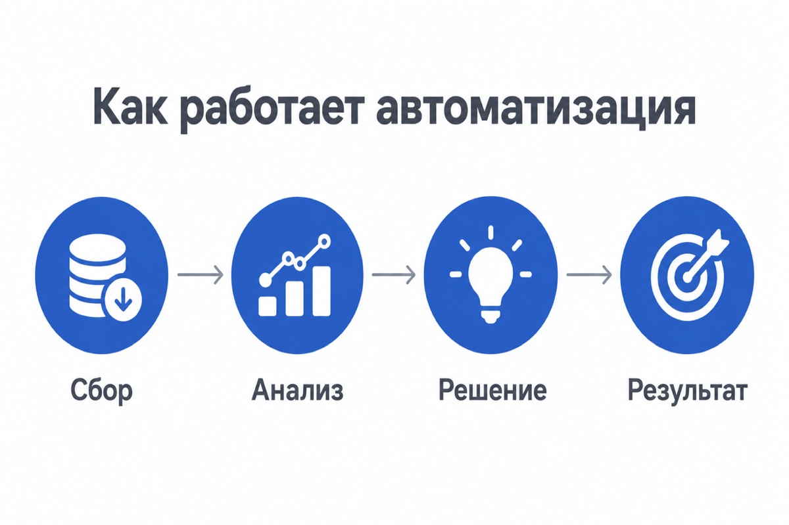
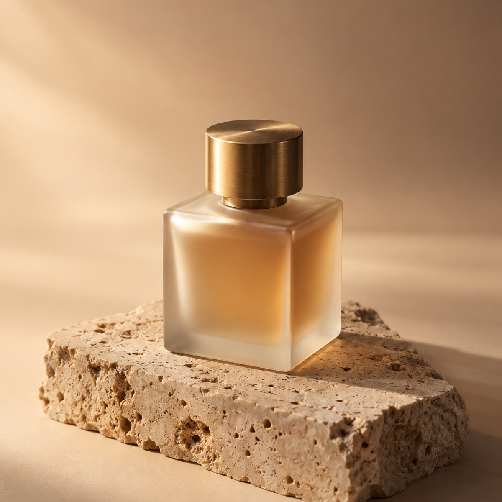
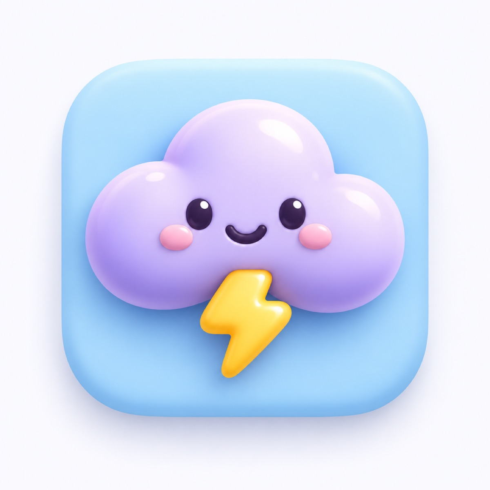
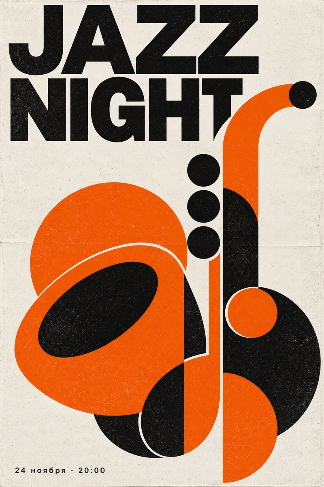
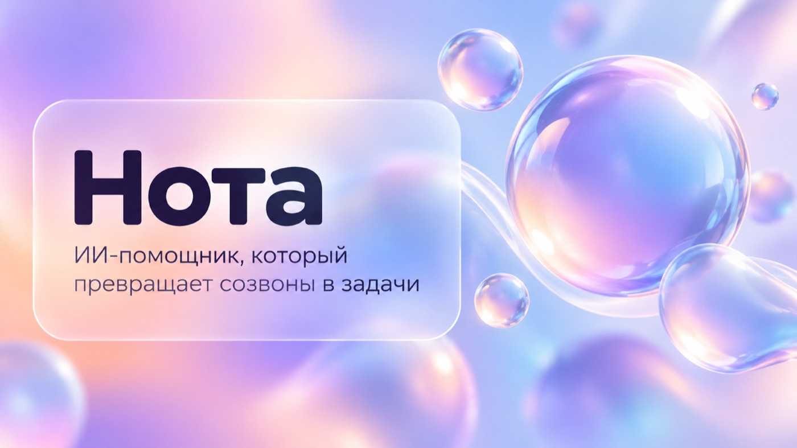
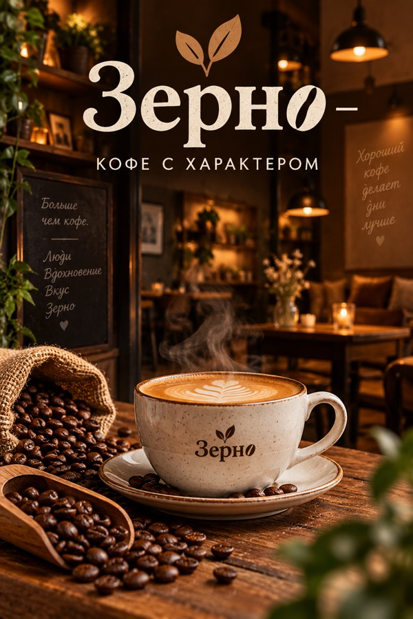
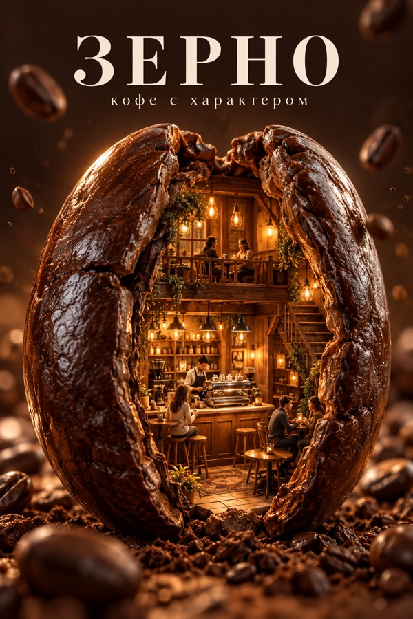

<div align="center">

# GPT Image 2 для Claude

**Claude теперь рисует. Картинки, обложки, постеры и целые презентации в GPT Image 2 по вашей подписке ChatGPT, без API-ключей.**

 
  

 

<sub>Все картинки и слайды выше сгенерированы этим навыком. Слайды — стиль «Стекло и градиент» из каркаса <code>examples/product-launch</code>. Промпты картинок лежат рядом: <code>assets/demo/*.prompt.txt</code></sub>

</div>

---

## Что это

Навык (skill) для Claude Code. Вы пишете «нарисуй обложку для ролика про нейросети», и Claude сам:

1. проходит режиссёрский бриф: пачка концепций, выбор лучшей, кадр, свет, палитра, риски — и собирает из него промпт,
2. отправляет его в **GPT Image 2** — лучший генератор с чистым текстом на картинке, в том числе на русском,
3. сохраняет PNG и **сам смотрит результат**; если что-то не так, исправляет.

Генерация идёт **через вашу подписку ChatGPT**, а не через платный API. Ключи не нужны.

## Режиссёрский бриф: в чём разница

Перед каждой картинкой Claude проходит бриф, как арт-директор: цель и зритель, **пачку разных концепций** (от очевидной до безумной), крючок кадра, композиция, оптика, свет, палитра, фактуры, текст, риски. Промпт собирается только из ответов. Ниже — одна и та же задача:

| Промпт «с ходу» | Промпт по брифу |
|:---:|:---:|
|  |  |
| стоковая кофейня, модель сама дописала надписи на досках и логотип на чашке | идея «кофейня внутри зерна», ничего лишнего ([бриф](assets/demo/ab-B3.brief.md)) |
|  |  |
| клише с пачками денег, взгляд цепляется за всё сразу | одна ясная шутка, читается даже в мелкой сетке |

## Что умеет

| | |
|---|---|
| 🎨 **Одиночные картинки** | обложки, превью, постеры, предметка, иконки, инфографика, интерьеры, еда |
| 🧑 **Люди с ваших фото** | эксперт узнаваем в любой сцене и любом стиле: супергерой, Симпсоны, парашют, потолстел или помолодел; отбор лучших снимков, проверка сходства, правка конкретного фото (`--base`) |
| ⚡ **Пачки** | несколько вариантов параллельно из одного JSON |
| 📊 **Презентации** | план → слайды → готовый `.pptx` в одном из 25 стилей |
| 🧩 **Свой шаблон** | дайте ваш `.pptx`, и новые слайды повторят его стиль |
| 🖼 **Реальные фото на слайдах** | логотипы и скриншоты можно вставить 1:1 отдельными объектами или вписать в стиль |
| ✏️ **Точечные правки** | «поменяй подзаголовок на 3-м слайде» — остальное не трогается |
| 🔤 **Типографика** | нет текста в задаче — ни одной случайной буквы; есть — продуманный шрифт, иерархия, кегль и безопасные зоны площадки; кириллица без каракулей |

## Как это работает

```
Вы ─► Claude ─► scripts/gen_image.py ─► Codex CLI ─► GPT Image 2 ─► PNG ─► Claude проверяет
```

Codex — официальный CLI-агент OpenAI, он уже есть внутри приложения ChatGPT для macOS. Навык запускает его в фоне и просит нарисовать картинку встроенным генератором. Всё работает локально, под вашим аккаунтом.

## Установка

**Нужно:**
- [Claude Code](https://claude.com/claude-code)
- Python 3.9+
- подписка ChatGPT и Codex CLI с входом под ней:
  - **macOS:** просто установите приложение [ChatGPT](https://chatgpt.com/download), Codex уже внутри;
  - **любая ОС:** `npm i -g @openai/codex`, затем `codex login`.

**Ставим навык:**

```bash
git clone https://github.com/<ваш-аккаунт>/gpt-image2.git
```
```bash
bash gpt-image2/install.sh
```

Установщик скопирует навык в `~/.claude/skills/gpt-image2`, поставит зависимости для презентаций в отдельное окружение и проверит связь с Codex. Перезапустите Claude Code — готово.

Проверить в любой момент:

```bash
python3 ~/.claude/skills/gpt-image2/scripts/doctor.py --render
```

## Как пользоваться

Просто пишите Claude обычным языком:

> Нарисуй превью для YouTube: «НЕЙРОСЕТЬ ЗА 5 МИНУТ», неоновый мозг над ноутбуком.

> Сделай 4 варианта иконки приложения для погоды в стиле мягкого 3D.

> Вот три моих фото — сделай студийный портрет на тёмном фоне.

> Сделай презентацию для инвестора на 8 слайдов, стиль «Чистый технологичный синий».

Claude сам подберёт формат, напишет промпт, сгенерирует, посмотрит и покажет результат.

### Вручную, без Claude

```bash
cd ~/.claude/skills/gpt-image2

# одна картинка
python3 scripts/gen_image.py --prompt "Минималистичный жёлтый кубик Рубика на тёмно-синем фоне" --aspect 1:1 --out out/cube.png

# пачка параллельно (пример: examples/batch/jobs.json)
python3 scripts/gen_image.py --batch examples/batch/jobs.json --jobs 3
```

Форматы: `1:1` · `16:9` · `9:16` · `3:2` · `2:3` · `4:3` · `3:4`.

## Стили презентаций

25 стилей, каждый расписан на русском: палитра, шрифты с кириллицей, правила для обложки, контента, цифр, разделителей и финала. Полный список — в [styles/CATALOG.md](styles/CATALOG.md).

**Базовые:** Чистый технологичный синий · Тёмное сияние · Журнальная вёрстка · Стекло и градиент · Скетчноут · Ваби-саби · Ризограф · Швейцарская сетка · Ретро-вектор · Хром Y2K

**Нишевые:** Арт-галерея · Конфетная инфографика · Креативное агентство · Гастро · Дата-консалтинг · Эко-бизнес · Fashion-консалтинг · Защита работы · Первое впечатление · Цветочный · Лавандовое портфолио · Деловая геометрия · Инвест-компания · Повестка встречи · Майнд-карта

Готовые каркасы презентаций (запуск продукта, инвест-питч, отчёт, урок, защита, разбор книги) лежат в [examples/](examples/).

## Как писать промпты

Формула, рецепты по жанрам и работа с текстом на картинке — в [references/prompting.md](references/prompting.md). Коротко:

> **что это → объект → композиция → окружение → свет → стиль и палитра → точный текст «в кавычках» → чего быть не должно**

## Вопросы

**Это бесплатно?** Навык бесплатный. Картинки расходуют лимиты вашей подписки ChatGPT так же, как генерация в самом ChatGPT.

**Почему не через API?** API — отдельная оплата за каждую картинку и возня с ключами. Через Codex вы используете то, за что уже платите.

**Сколько ждать?** 30–90 секунд на картинку. Пачки идут параллельно, по 3 по умолчанию.

**Работает на Windows / Linux?** Да, если установлен Codex CLI (`npm i -g @openai/codex`) и выполнен вход. Путь к нему можно задать через `CODEX_CMD`.

**Что-то сломалось.** Запустите `python3 scripts/doctor.py`: он покажет, чего не хватает.

## Структура

```
gpt-image2/
├── SKILL.md            ← инструкция для Claude
├── install.sh          ← установка
├── scripts/
│   ├── gen_image.py    ← картинки и пачки
│   ├── generate_ppt.py ← презентации
│   ├── codex_backend.py← мост к Codex
│   ├── faces.py        ← отбор фото людей и проверка сходства
│   └── doctor.py       ← диагностика
├── references/         ← бриф, промпты, лица, типографика, слайды, шаблоны, правки
├── styles/             ← 25 стилей + каталог
└── examples/           ← каркасы презентаций
```

## Лицензия

Apache License 2.0 — см. [LICENSE](LICENSE) и [NOTICE](NOTICE).

<div align="center"><sub>Сделано Юрием Слепнёвым</sub></div>
